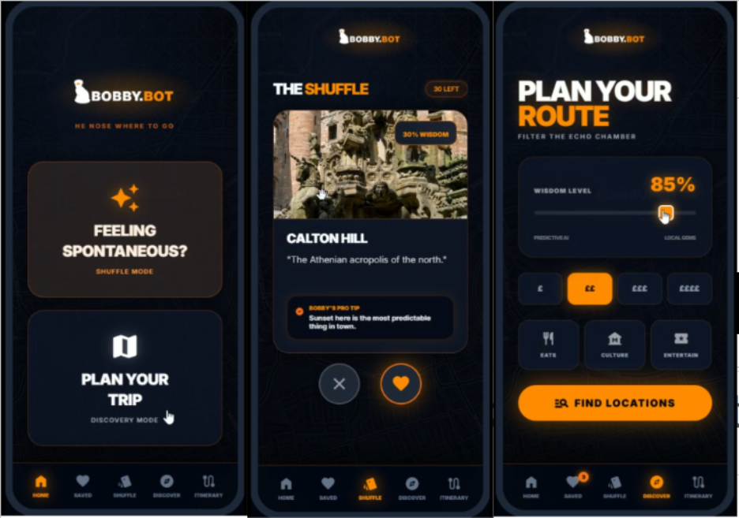
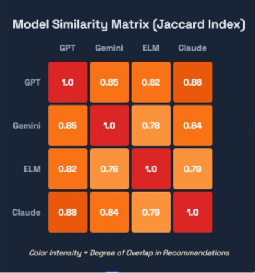
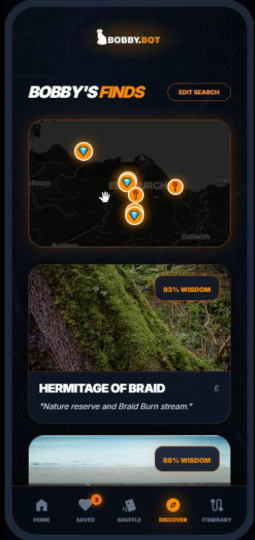
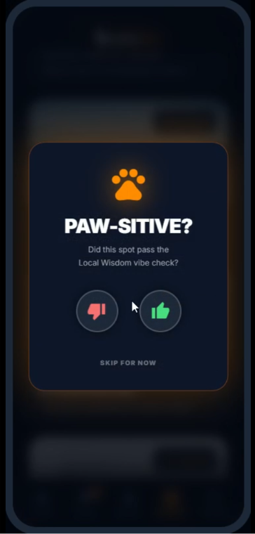
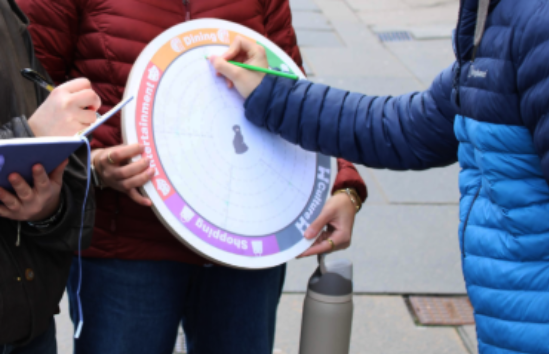

# Bobby.Bot 🐾

**An AI city guide that helps visitors find Edinburgh's hidden gems instead of the same ten tourist spots.**

Team project for *Data, Design and the City* at the University of Edinburgh (2026), with input from Josh Ryan-Saha, Director of the University's Traveltech Innovation Hub.

> This was a research and design proof of concept, not a launched product.



## The problem

Edinburgh gets millions of visitors a year, and most of them end up in the same few places in the Old Town. Meanwhile, independent businesses a few streets away struggle. AI travel tools make this worse.

We asked four AI models the same question: *"I'm visiting Edinburgh for the first time; give me 10 locations to check out."* Then we measured how similar their answers were using the **Jaccard index**.



**Their answers overlapped by 78–88%.** Every model sent visitors to the same castle, the same street and the same hill.

## What we built

- **Wisdom Level slider.** Users choose how far off the beaten path they want to go, so the AI's choices are visible instead of a black box.
- **Two modes.**
  - **Shuffle:** swipe through nearby spots, for spontaneous exploring.
  - **Discovery:** a map-based planner, for planning ahead.
- **Paw-sitive? reviews.** A one-tap "glad you went?" prompt, like rating an Uber ride, instead of long review forms.

| Map results | Paw-sitive? review |
|---|---|
|  |  |

## How recommendations are filtered

Bobby.Bot passes each place through three filters. There's a Python version in [`src/filtering.py`](src/filtering.py), with tests in `tests/`.

1. **Wisdom score (0–100).** This measures how far a place is from mainstream algorithmic picks. A place is shown if its score is within ±45 of the slider. The slider defaults to 85, which favours hidden gems.
2. **Local credibility.** A high rating with few reviews ranks higher than a high rating with huge review counts. Dr Neil's Garden (5★, 103 reviews) beats Edinburgh Castle (4★, 22,841 reviews).
3. **Category and budget.** Places are limited to Culture, Dining and Entertainment, the niche we found in our research, plus a budget from £ to ££££.

```bash
pip install -r requirements.txt
pytest                      # run the filtering tests
python analysis/plot_wheel.py   # redraw the survey chart
```

## Research process

We worked with real users rather than designing for them:

1. **Expert interview.** Josh Ryan-Saha told us *"If you're for everyone, you're for no one,"* which pushed us to find a niche and to design for trust.
2. **Focus group.** Both participants wanted one mode for planning and one for spontaneous exploring, so we built **two modes**.
3. **Wheel survey on the Royal Mile.** 20 tourists rated five categories each.



| Category | Score (/100) |
|---|---|
| Culture | **83** |
| Dining | **80** |
| Entertainment | **74** |
| Nature | 66 |
| Shopping | 52 |

The clear Culture–Dining–Entertainment cluster became Bobby.Bot's niche.

## My role

- Built the technical implementation, including the three-layer filtering logic.
- Ran the AI similarity test and built the Jaccard similarity matrix.
- Moderated the focus group and managed the research side of the project.

**Team:** Ben, Caitlyn, Liam, Mitchell and Mitra.

## Limitations and next steps

- The interface hasn't been tested with real users yet. The next step would be a beta with 50–100 people.
- It needs a reliable dataset of local places, which would probably mean partnering with community organisations.
- If a hidden gem gets popular, it stops being hidden. The system would need to track whether it actually spreads visitors out.

## Tech

Python · AI prototyping tools · Jaccard similarity · participatory design (focus group, wheel survey)
